  <picture>
    <source media="(max-width: 600px)" srcset="./assets/generated/galaxy-header-mobile.svg">
    
  </picture>

**星图导览** · 两条旋臂分别对应 AI 推理和数学建模。标注名称的星对应下方的公开仓库。

## 项目轨道 · Projects

### 01 · AI 与推理

[**submission**](https://github.com/zhuzihao127-pixel/submission) · Python 推理代码 
*Python inference code.*

### 02 · 数学建模

[**GMCM_LaTeX_overleaf**](https://github.com/zhuzihao127-pixel/GMCM_LaTeX_overleaf) · 2025 年研究生数学建模竞赛 Overleaf 模板 
*Overleaf template for the 2025 graduate mathematical modeling competition.* Fork 自 [springli07](https://github.com/springli07/GMCM_LaTeX_overleaf)。

[浏览全部公开仓库 ↗](https://github.com/zhuzihao127-pixel?tab=repositories)

## 贡献曲线 · GitHub Activity

  <picture>
    <source media="(max-width: 600px)" srcset="./assets/generated/stats-card-mobile.svg">
    
  </picture>

圆点对应每周贡献次数，曲线是 5 周移动平均，发光的星标出贡献最多的一周。

星图由 <a href="https://github.com/vinimlo/galaxy-profile">galaxy-profile</a>（GPL-3.0）生成。
